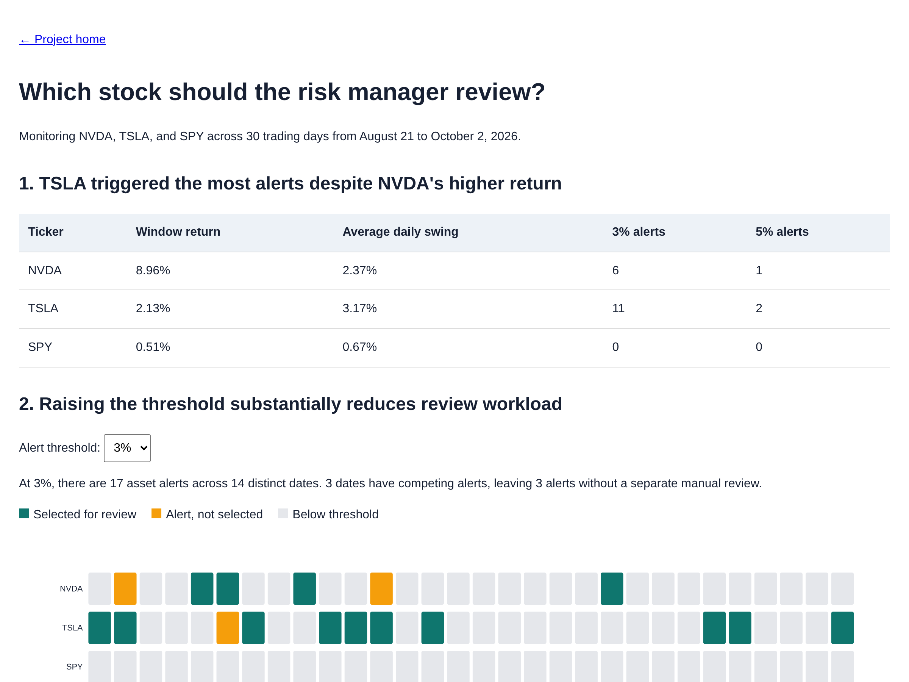
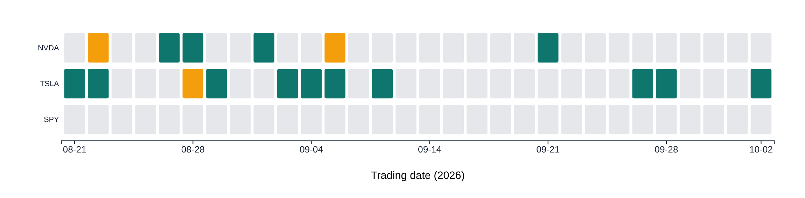
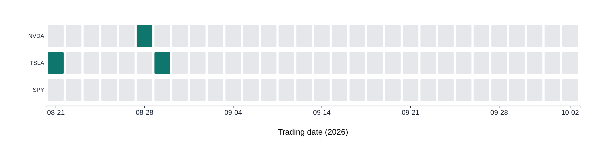

# Stock Monitoring & Data Storytelling

A small end-to-end stock-monitoring project for **NVDA, TSLA and SPY**:
an Airflow pipeline that fetches prices and flags high-volatility days, a Spark job that
simulates streaming ingest, and a D3 data story and live tracker that present the results.

**Question:** a risk manager can review only one asset per trading day. Should the alert fire at a
3% or a 5% intraday price swing?



## Findings (30 trading days, Aug 21 – Oct 2, 2026)

| Ticker | Window return | Avg daily swing | 3% alerts | 5% alerts |
|---|---:|---:|---:|---:|
| NVDA | 8.96% | 2.37% | 6 | 1 |
| TSLA | 2.13% | 3.17% | 11 | 2 |
| SPY  | 0.51% | 0.67% | 0 | 0 |

- **TSLA produced the most alerts, even though NVDA had the higher return.** Return and intraday swing measure different things.
- **At 3%:** 17 alerts fall on 14 dates. On three dates two stocks alert at once, so three alerts get no separate review.
- **At 5%:** only 3 alerts fall on 3 dates and none overlap, but 11 of the 14 review dates disappear.
- **Recommendation:** trial 3% with a largest-swing-first rule (at most one review per day), and keep a log of the alerts that weren't reviewed.

| 3% threshold | 5% threshold |
|---|---|
|  |  |

## Architecture

```text
 Yahoo Finance ──► Airflow DAG ───────────────────────────────────► data/watchlist*/ ──► story.html (D3)
                  fetch_data → analytics_and_summary → alert_notification       (CSV)
                  pipeline/fetch_watchlist.py   pipeline/watchlist_metrics.py

 Massive API ──► stock_server.py (/api/stocks, rate-limited) ─────────────────────────► tracker.html

 Massive API ──► Spark streaming ingest: 5-min pulls of 1-min bars
                 → left anti-join merge → 30-min moving averages
```

## Repository layout

```text
├── index.html                 landing page
├── story.html, story.js       D3 alert data story (static)
├── tracker.html, tracker.js   live price tracker (needs stock_server.py)
├── stock_server.py            local server: static files + /api/stocks
├── data/
│   ├── watchlist/             saved 30-day snapshot used in the story (+ provenance.json)
│   └── tracker_evidence.json  sample tracker session export
├── pipeline/
│   ├── fetch_watchlist.py     yfinance download → stock_daily.csv
│   ├── watchlist_metrics.py   validation, swings, alerts, review workload
│   ├── airflow/watchlist_dag.py
│   └── spark/streaming_ingest.py
├── notebooks/watchlist_analysis.ipynb   exploratory version of the analysis
└── docs/methodology.md        formulas, data settings, validation checks, limitations
```

## Quickstart

```bash
pip install -r requirements.txt
```

**Data story** (no API key needed):

```bash
python -m http.server 8000
# open http://localhost:8000/story.html
```

**Live tracker** (needs a free [Massive](https://massive.com) API key):

```bash
export MASSIVE_API_KEY=your_key        # PowerShell: $env:MASSIVE_API_KEY="your_key"
python stock_server.py                 # prompts for the key if the variable is not set
# open http://127.0.0.1:8001/tracker.html
```

The tracker shows split-adjusted end-of-day closes and refreshes 90 seconds after each cycle finishes.
API requests are spaced at least 13 seconds apart to respect the free tier.
To track other symbols, set `STOCK_TICKERS=AAPL,MSFT,GOOGL`. The sample export in
`data/tracker_evidence.json` was recorded with those three tickers.

**Recompute the metrics** from the saved snapshot (reproduces `data/watchlist/` byte-for-byte):

```bash
python -m pipeline.watchlist_metrics data/watchlist/stock_daily.csv data/watchlist
```

**Run the pipeline** on fresh data:

```bash
# Without Airflow
python -m pipeline.fetch_watchlist data/watchlist_latest --days 30
python -m pipeline.watchlist_metrics data/watchlist_latest/stock_daily.csv data/watchlist_latest

# With Airflow: link the DAG into your dags folder, then trigger watchlist_volatility_pipeline
ln -s "$(pwd)/pipeline/airflow/watchlist_dag.py" ~/airflow/dags/
```

Then open `story.html?data=latest` to see the new run in the table and grid. The written narrative
always describes the saved snapshot.

**Spark streaming ingest:**

```bash
export MASSIVE_API_KEY=your_key
python pipeline/spark/streaming_ingest.py --ticker AAPL --base-time 2025-09-25T10:00 --fast
```

The job makes 7 pulls (one every 5 minutes over 30 minutes), each covering the previous hour of
1-minute bars. A left anti-join lets each newer pull replace overlapping rows, so the job ends with
about 1.5 hours of unique bars and their 30-minute moving averages. `--fast` skips the real waits
between pulls.

## Tech

Python · pandas · yfinance · Apache Airflow · PySpark · D3.js v7 · HTML/CSS/JS ·
Massive (Polygon.io) REST API

## Limitations

This is a retrospective, after-the-close screen over one 30-day window. Daily high and low prices
don't show *when* a threshold was crossed during the day. The analysis also leaves out news,
liquidity and portfolio exposure. Neither threshold is optimized, and none of this is investment
advice. See [docs/methodology.md](docs/methodology.md) for details.
